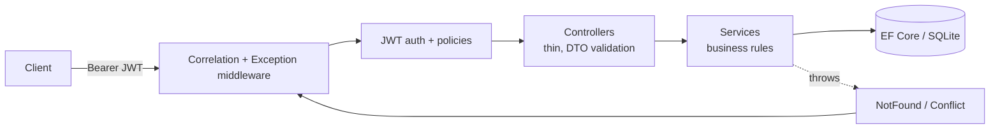
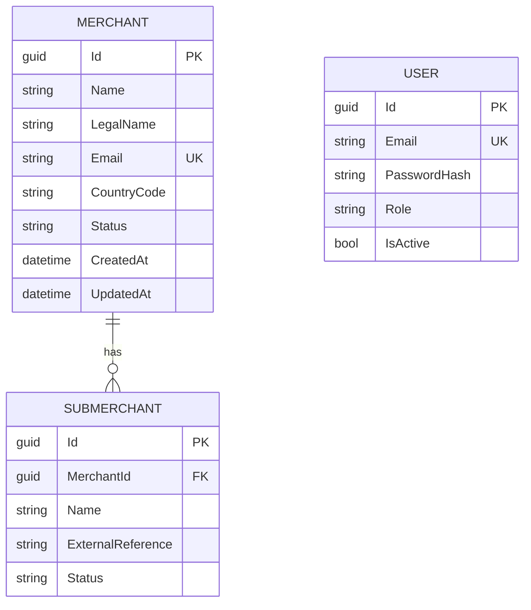

# Merchant Management API

A secure, documented REST API for managing **merchants and their sub-merchants**, built with ASP.NET Core (.NET 8),
EF Core and JWT authentication. It demonstrates API design, role-based access control, relational modelling and
defensive backend engineering.

> All data is synthetic and the code is original. It contains nothing from any employer.

## Problem

Payment and marketplace platforms need to onboard merchants (and the sub-merchants that trade under them),
control who may view or change them, and keep that data consistent. This service provides that core with
secure defaults: every endpoint requires authentication unless explicitly opened, writes are role-restricted,
and errors never leak internals.

## Features

- Merchant and sub-merchant CRUD with lifecycle status (`Pending`, `Active`, `Suspended`, `Closed`)
- JWT authentication and role-based authorization (`Viewer`, `Manager`, `Admin`)
- Input validation with RFC 7807 problem responses
- Pagination, sorting (whitelisted fields) and filtering on both list endpoints
- Global exception handling, structured JSON logging with a correlation id per request
- Swagger/OpenAPI with bearer-token support (Development)
- Unit and integration tests, Dockerfile, docker-compose, GitHub Actions CI

## Architecture



Layering is deliberately light: controllers → services → `DbContext`. There is no repository layer because EF Core's
`DbContext` already is a unit of work and repository; wrapping it would add code without adding value at this size.
Splitting into multiple assemblies (Clean Architecture) is not justified for a service of this scope.

### Data model



Design choices: GUID keys (no enumerable ids); unique indexes on merchant email, user email and
`(MerchantId, ExternalReference)`; indexes on `Name`, `Status`, `CreatedAt` for the list queries; cascade delete from
merchant to sub-merchants; enums stored as readable strings. Uniqueness is checked in code for a friendly `409`
**and** enforced by the database, with the exception handler mapping a violated constraint to `409` if two requests race.

## Roles

| Capability | Viewer | Manager | Admin |
|---|:-:|:-:|:-:|
| Read merchants / sub-merchants | ✅ | ✅ | ✅ |
| Create / update merchants and sub-merchants, delete sub-merchants | ❌ | ✅ | ✅ |
| Delete merchants | ❌ | ❌ | ✅ |
| Create / list / deactivate users | ❌ | ❌ | ✅ |

Business rules: a `Closed` merchant or sub-merchant cannot be reopened; sub-merchants cannot be added to a
`Suspended` or `Closed` merchant; an admin cannot deactivate their own account.

## Security design

- **Secure by default:** a global fallback policy requires authentication; only `/api/auth/login` and `/health` are anonymous.
- **JWT:** HMAC-SHA256, issuer/audience/lifetime/signature validated, algorithm pinned, 30 s clock skew, 30 min default lifetime.
  The signing key comes only from configuration and the app **refuses to start** if it is missing or under 32 characters.
- **Passwords:** hashed with ASP.NET Core Identity's `PasswordHasher` (PBKDF2); never stored or logged in plaintext. Minimum length 12.
- **Login:** one generic `401` for unknown user, wrong password and disabled account; a dummy hash verification narrows timing differences.
- **No default credentials:** the first Admin is created from `Bootstrap__AdminEmail` / `Bootstrap__AdminPassword` only when no users exist.
- **Injection:** all queries are parameterised by EF Core; search text is LIKE-escaped so `%` and `_` are literal; sort fields are whitelisted.
- **Errors:** unexpected exceptions are logged server-side and returned as a generic problem response with a trace/correlation id.
- **Logs:** structured JSON; passwords, tokens and submitted emails on failed login are not logged. Incoming correlation ids are validated to prevent log injection.

## Run it

Prerequisite: .NET 8 SDK (or Docker).

```bash
export Jwt__Key="$(openssl rand -base64 48)"
export Bootstrap__AdminEmail="admin@example.com"
export Bootstrap__AdminPassword="choose-a-strong-password"
ASPNETCORE_ENVIRONMENT=Development dotnet run --project src/MerchantManagement.Api
# Swagger UI: http://localhost:<port>/swagger
```

Docker:

```bash
cp .env.example .env    # then edit the three values
docker compose up --build
```

## API examples

```bash
BASE=http://localhost:8080

# Log in
TOKEN=$(curl -s -X POST $BASE/api/auth/login -H 'Content-Type: application/json' \
  -d '{"email":"admin@example.com","password":"choose-a-strong-password"}' | jq -r .accessToken)

# Create a Manager account (Admin only)
curl -X POST $BASE/api/users -H "Authorization: Bearer $TOKEN" -H 'Content-Type: application/json' \
  -d '{"email":"manager@example.com","password":"a-long-manager-password","role":"Manager"}'

# Create a merchant
curl -X POST $BASE/api/merchants -H "Authorization: Bearer $TOKEN" -H 'Content-Type: application/json' \
  -d '{"name":"Acme Traders","legalName":"Acme Traders Pvt Ltd","email":"ops@acme.example","countryCode":"PK"}'

# Search, filter, sort, page
curl "$BASE/api/merchants?search=acme&status=Active&sortBy=name&desc=false&page=1&pageSize=20" \
  -H "Authorization: Bearer $TOKEN"

# Add a sub-merchant
curl -X POST $BASE/api/merchants/{merchantId}/sub-merchants -H "Authorization: Bearer $TOKEN" \
  -H 'Content-Type: application/json' -d '{"name":"Lahore Store","externalReference":"STORE-001"}'
```

### Endpoints

| Method | Path | Access |
|---|---|---|
| POST | `/api/auth/login` | anonymous |
| GET / POST | `/api/users` | Admin |
| POST | `/api/users/{id}/deactivate` | Admin |
| GET | `/api/merchants` · `/api/merchants/{id}` | Viewer+ |
| POST · PUT | `/api/merchants` · `/api/merchants/{id}` | Manager+ |
| DELETE | `/api/merchants/{id}` | Admin |
| GET | `/api/merchants/{id}/sub-merchants` · `/{subId}` | Viewer+ |
| POST · PUT · DELETE | `/api/merchants/{id}/sub-merchants[/{subId}]` | Manager+ |
| GET | `/health` | anonymous |

List endpoints accept `page` (≥1), `pageSize` (1–100), `search`, `status`, `sortBy`, `desc`.

## Tests

```bash
dotnet test
```

Coverage: login success/failure, token tampering/expiry/wrong key, hashed password storage, user management and
deactivation, full role matrix, validation, duplicate handling, merchant lifecycle rules, paging/sort/filter,
LIKE-wildcard safety, sub-merchant uniqueness and ownership, cascade delete, correlation ids, and the
exception handler (including that internals do not leak).

## Known limitations / future improvements

- SQLite keeps the demo zero-setup. For production use SQL Server/PostgreSQL/MySQL/Oracle by swapping the EF provider; schema is created with `EnsureCreated`, so add migrations first.
- Access tokens only: no refresh tokens or revocation list (deactivation takes effect at next login, not mid-token).
- No login rate limiting or account lockout (planned for the Secure Authentication & RBAC project).
- No optimistic concurrency token (`rowversion`) on updates; last write wins.
- No audit trail table; actions are logged but not persisted as audit events.
- HTTPS termination and CORS are expected to be handled by the hosting layer and are not configured here.

## License

MIT
